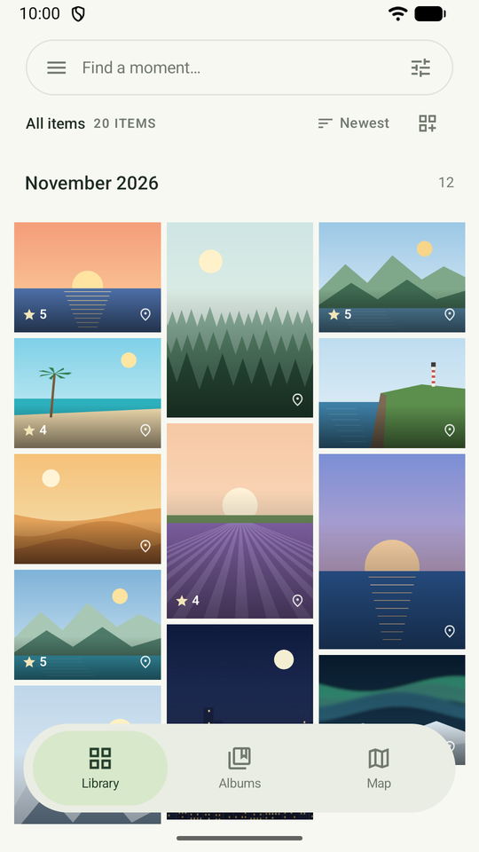
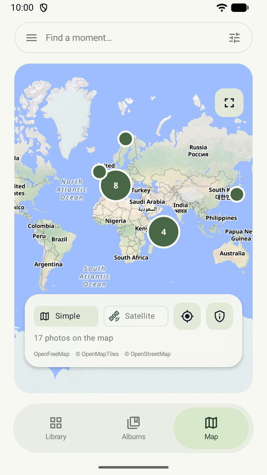
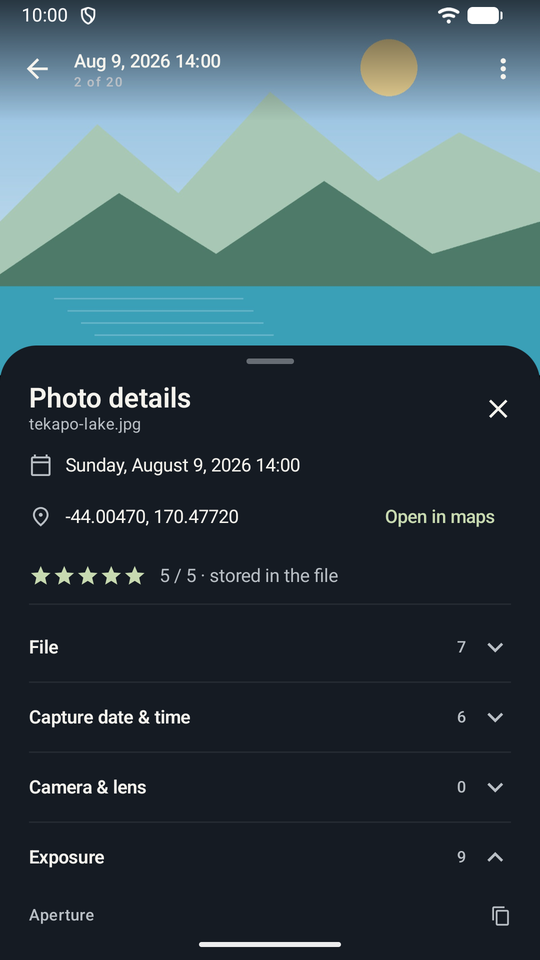

# Local Gallery

A calm, fast gallery for the photos and videos on your Android phone. Everything stays on the device: no account, no ads, no analytics, and nothing is uploaded.

<p>
  
  
  
</p>

## Features

- Photos, videos and folders by month, as grid, masonry or list
- Search and filters for rating, camera, date, GPS, size and exposure, saved as favorites
- Map of where photos were taken, with a simple and a satellite view
- Photos grouped by country, worked out on the phone without an online service
- Albums without copying files, linked folders and home-screen widgets
- Viewer with zoom, video playback, animated GIFs and full photo details
- Crop, rotate and draw on a copy; move files between folders with undo
- Bin with restore (Android 11+) and a separate page for hidden media

More detail: [docs/guide.md](docs/guide.md)

## Install

Status: the Google Play release is in review. Once it is live, the app is at
[play.google.com/store/apps/details?id=com.norfila.gallery](https://play.google.com/store/apps/details?id=com.norfila.gallery).
Until then, build it from source.

Android 8.0 or newer. The app is in English and German.

## Permissions

- **Photos and videos** (media or storage access): to show and manage your library.
- **Photo locations** (`ACCESS_MEDIA_LOCATION`): to read GPS from photos for the map and countries. The app never asks for your current location.
- **Internet**: only for the online map, and only after you agree to load it.
- **Media management** (`MANAGE_MEDIA`, Android 12+, optional): moves and deletes without Android asking each time.
- **Wallpaper**: to set a photo as wallpaper.
- **All files access** (sideloaded full version only, optional): for the Hidden page.

The privacy policy is in [docs/privacy](docs/privacy/privacy-policy.html) and inside the app under Settings.

## Build from source

Requires JDK 21 and the Android SDK (API level 36). On Windows:

```powershell
.\gradlew.bat :app:assembleFullDebug
```

On macOS or Linux, `./gradlew :app:assembleFullDebug`. The APK is written to `app/build/outputs/apk/full/debug/`. The project builds two versions, a sideloaded one and the Google Play one; tests, signing and the build script are described in [docs/development.md](docs/development.md).

## License

GPL-3.0-or-later. Copyright © 2026 Norfila. See [LICENSE](LICENSE).

Country borders: [Natural Earth](https://www.naturalearthdata.com/) (public domain). Map: [OpenFreeMap](https://openfreemap.org/), © OpenMapTiles, © [OpenStreetMap contributors](https://www.openstreetmap.org/copyright). Satellite view: EOxCloudless by EOX IT Services GmbH, contains modified Copernicus Sentinel data 2025, [CC BY-NC-SA 4.0](https://creativecommons.org/licenses/by-nc-sa/4.0/).
